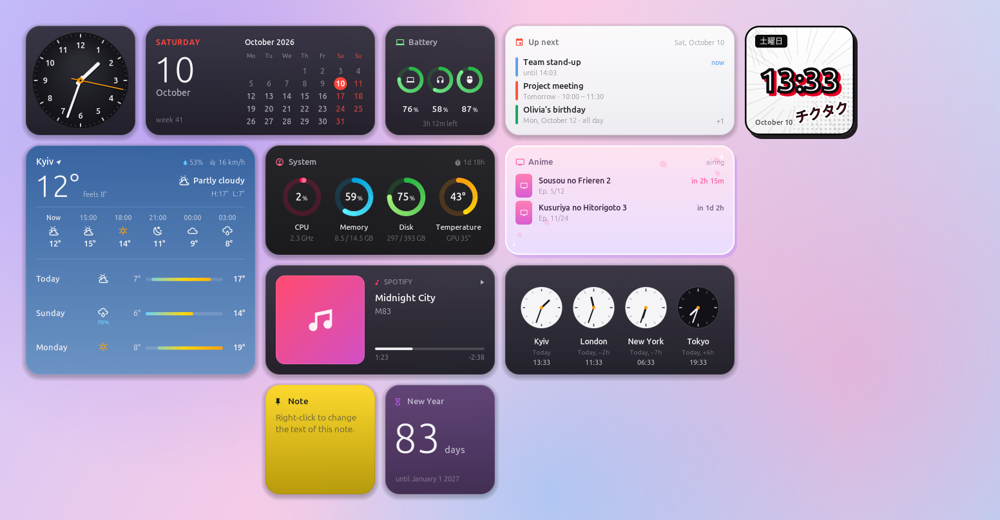
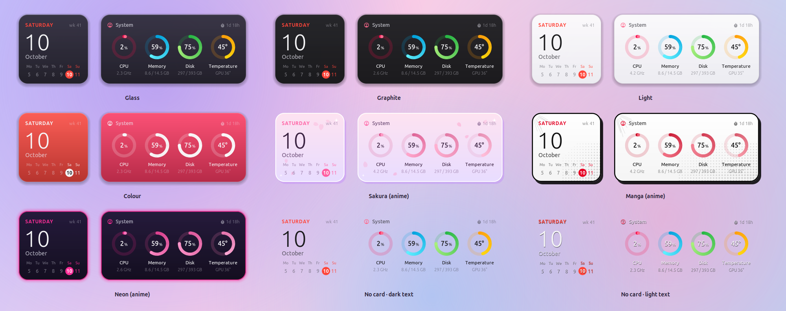
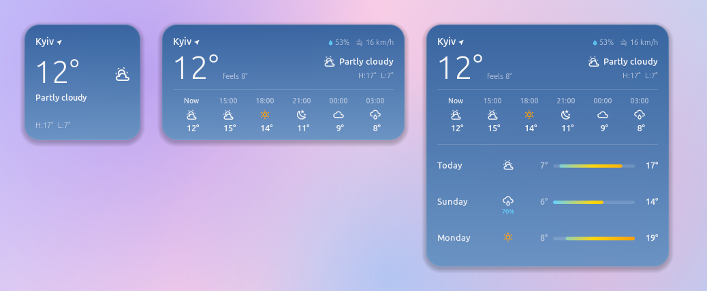
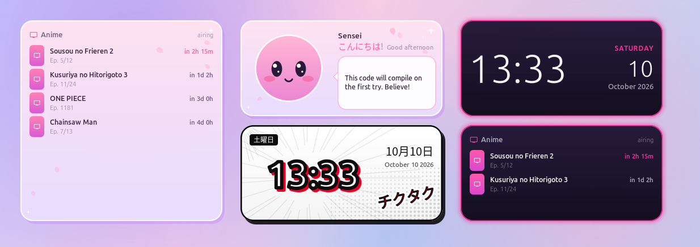

# DeskWidgets

**macOS-style desktop widgets for Linux and Windows** — clocks, calendar, weather, system monitors, now playing,
events, notes, exchange rates, Docker… and anime widgets. They snap to a grid, come in three sizes
and nine styles with any accent colour, every widget has its own settings, and writing your own
widget is a folder with two files.

🇺🇦 [Українською](README.uk.md)



## Features

* **21 widgets**: analog & digital clock, world clock, calendar (week/month), weather (now, hourly,
  3 days), up next (GNOME calendars, incl. Google), now playing (any MPRIS player, cover art, click to
  pause), system, processor, memory, disks, network (+ unknown-device watch), batteries (+ Bluetooth
  devices and Pulsar/Kysona-style 2.4 GHz gaming mice), Docker, note, countdown, picture, hryvnia exchange rates, and **anime**: next episodes from
  AniList, manga clock, anime buddy.
* **Grid**: drag a widget with the mouse — the grid appears and the widget snaps into the nearest free cell.
* **One size setting**: Settings → Widget size, from 50 % to 120 %. The grid follows by itself: smaller widgets
  mean smaller cells and more of them, and every widget stays where it was on the screen.
* **Several monitors**: tick the monitors that show widgets (Settings → Monitors). Each has its own grid
  (on Windows its own DPI scale too); drag a widget onto another monitor, or pick one in its settings.
* **Three sizes** for every widget: small (1×1 cell), medium (2×1), large (2×2).
* **Nine styles** — Glass, Graphite, Light, Colour, Sakura, Manga, Neon, and borderless (dark or light
  text) — and **13 accent colours** that tint the card and the highlights.
* **Settings for each widget** (city, cities, currencies, text, dates, pictures…) with a live preview.
  Right-click a widget to open them. Add several copies of the same widget.
* **Write your own** widget in Lua with a small drawing API — `deskwidgets new my_widget` gives you a
  working template. See [docs/creating-widgets.md](docs/creating-widgets.md).
* Ukrainian and English UI. Runs on **Windows 10/11**, and on Linux under X11 and Wayland (through Xwayland).

| Styles | Sizes |
|---|---|
|  |  |



## Install

DeskWidgets needs Python 3.12+, [pycairo](https://pycairo.readthedocs.io), [lupa](https://github.com/scoder/lupa),
[psutil](https://github.com/giampaolo/psutil) and [Pillow](https://python-pillow.org); no other widget program.

### Windows 10 / 11

Install [Python](https://www.python.org/downloads/windows/) (tick "Add python.exe to PATH"), then in a terminal:

```bat
pip install deskwidgets        :: or, from a clone of this repository: pip install .
deskwidgets setup       :: autostart and a Start-menu entry
deskwidgets             :: start; the tray icon opens the gallery
```

Optional: `pip install winsdk` adds the "Now playing" widget (any player that shows in the volume flyout).
Widgets that need Linux services (Up next, mouse battery) say so in the gallery and are not offered.

### Debian, Ubuntu, Mint, Pop!_OS

Download `deskwidgets_<version>_all.deb` from [Releases](../../releases) and:

```sh
sudo apt install ./deskwidgets_*_all.deb
```

Then open **DeskWidgets** from the app menu (the first start sets up autostart and
<kbd>Super</kbd>+<kbd>Alt</kbd>+<kbd>W</kbd>).

### Any Linux distribution, from source

Needs an X11 session or Xwayland (GNOME, KDE Plasma, … have it), `python3` with `venv`, and — from your distribution —
the Python bindings below. PyGObject + GTK 4 + libadwaita ≥ 1.5 give the native gallery and the media/calendar services;
without them DeskWidgets uses the Tk gallery (`python3-tk`) and just skips those two widgets.

```sh
# Debian/Ubuntu
sudo apt install python3-venv python3-cairo python3-psutil python3-pil python3-gi gir1.2-gtk-4.0 gir1.2-adw-1 \
                 gir1.2-ecal-2.0 gir1.2-edataserver-1.2 fonts-noto-cjk
# Fedora
sudo dnf install python3-cairo python3-psutil python3-pillow python3-gobject gtk4 libadwaita \
                 evolution-data-server google-noto-sans-cjk-fonts
# Arch
sudo pacman -S python-cairo python-psutil python-pillow python-gobject gtk4 libadwaita evolution-data-server noto-fonts-cjk

git clone https://github.com/T0ks1k24/DeskWidgets
cd DeskWidgets
./install.sh            # into ~/.local; or: sudo ./install.sh --system
deskwidgets setup       # autostart, Super+Alt+W (GNOME), menu entry
deskwidgets             # start
```

Try it without installing: `python3 -m deskwidgets` from the checkout. Check what is missing: `deskwidgets doctor`.

**Wireless gaming mice** (Pulsar, Kysona, ATK, VXE … on Compx/CX receivers) report their battery only
over a vendor protocol; DeskWidgets reads it itself. A from-source install needs a udev rule once
(the .deb and `--system` install it): `deskwidgets mice` prints the exact command and the result.

## Use

| | |
|---|---|
| <kbd>Super</kbd>+<kbd>Alt</kbd>+<kbd>W</kbd> or **DeskWidgets** in the app menu | the gallery: your widgets, add new ones, settings |
| drag with the left mouse button | move a widget; the grid shows and it snaps to the nearest free cell |
| right-click a widget | its settings (size, style, colour, options, remove) |
| left-click | widget actions: pause music, open the show on AniList… |

<kbd>Super</kbd> is the <kbd>Win</kbd> key. On Windows the gallery hotkey is <kbd>Ctrl</kbd>+<kbd>Alt</kbd>+<kbd>W</kbd>
and the tray icon opens it too. Moving a widget with the window manager (<kbd>Super</kbd>+drag on GNOME) works as well.

The command line does the same:

```sh
deskwidgets types                 # every available widget
deskwidgets add weather           # add one (as many copies as you like)
deskwidgets list                  # what is on the desktop
deskwidgets configure weather-2   # settings window of one widget
deskwidgets arrange               # pack everything onto the grid
deskwidgets preview clock --size large --style sakura -o clock.png
deskwidgets quit
```

Configuration lives in `~/.config/deskwidgets/` (`%APPDATA%\\DeskWidgets` on Windows) — see [docs/configuration.md](docs/configuration.md).

## Make your own widget

```sh
deskwidgets new pomodoro
$EDITOR ~/.config/deskwidgets/widgets/pomodoro/widget.lua
deskwidgets reload && deskwidgets add pomodoro
```

A widget is `widget.json` (name, sizes, options → the settings window is generated from it) and
`widget.lua` (drawing). Read [docs/creating-widgets.md](docs/creating-widgets.md) and look at
[examples/](examples) and the built-in [widgets](deskwidgets/widgets). Pull requests with new widgets are welcome —
see [CONTRIBUTING.md](CONTRIBUTING.md).

## How it works

One Python service (`deskwidgets run`) owns every widget window. Each widget runs `widget.lua` in its own embedded
Lua ([lupa](https://github.com/scoder/lupa)) and draws with Cairo ([pycairo](https://pycairo.readthedocs.io)) into
a transparent window; Windows and Linux differ only in the small window layer (Win32 layered windows, or X11/Xwayland).
The service keeps widgets on the grid, feeds them live data (media player, calendars, Docker, batteries) and is
controlled by the CLI and the gallery over a local socket.

```
deskwidgets/
  core/         settings, widget catalog, grid, layout: plain logic, no windows
  engine/       the widget runtime: Lua + Cairo, fonts, images, system info; renders headless too
    lua/        lib.lua (the widget API) and main.lua
  platform/     one file per OS behind base.py: x11.py, win32.py; autostart and hotkeys (integration.py)
  providers/    background data: media player, calendars, Docker, batteries
  service/      the daemon: widget windows, dragging, the control socket
  gallery/      the gallery window: GTK 4 (Linux) or Tk (Windows)
  widgets/      the built-in widgets: widget.json + widget.lua (+ helper scripts)
  assets/       icon font, icons, udev rule
tests/          pytest: engine, service, providers, backends
examples/       widgets to copy from
packaging/      .deb build, screenshots
```

## Credits

* [Cairo](https://www.cairographics.org) draws everything, [Lua](https://www.lua.org) (through [lupa](https://github.com/scoder/lupa)) runs the widgets.
* Icons: [Material Design Icons](https://pictogrammers.com/library/mdi/) (Pictogrammers Free License / Apache 2.0, bundled in `fonts/`).
* Data: [wttr.in](https://wttr.in), [AniList](https://anilist.co).

## License

MIT — see [LICENSE](LICENSE). The bundled icon font keeps its own license.
