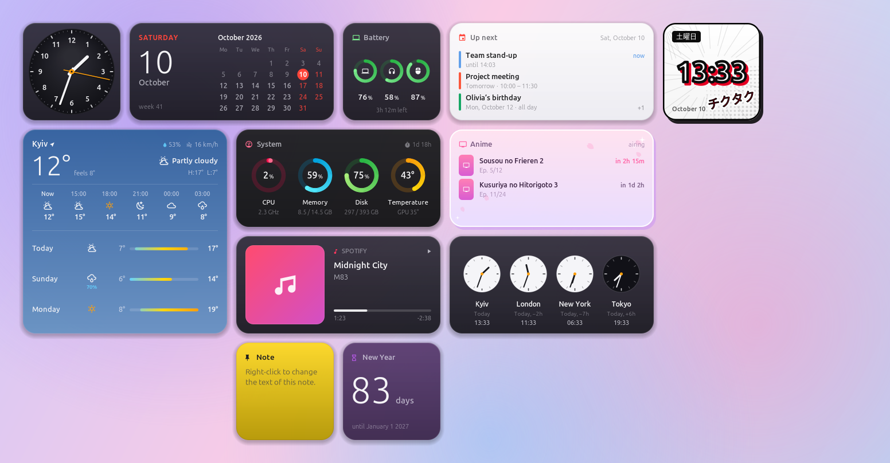
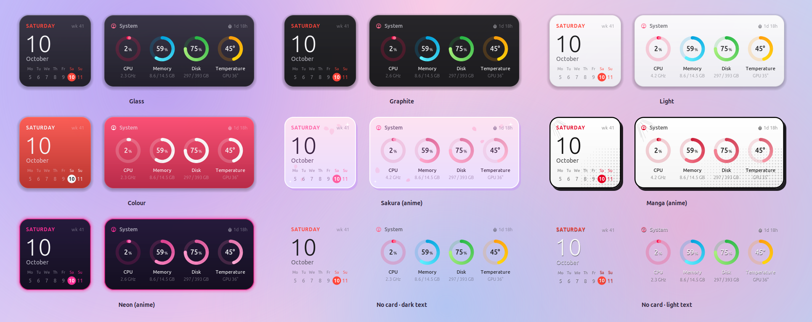
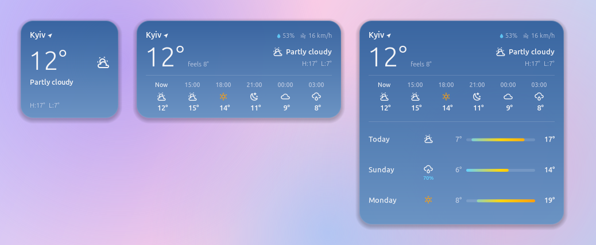
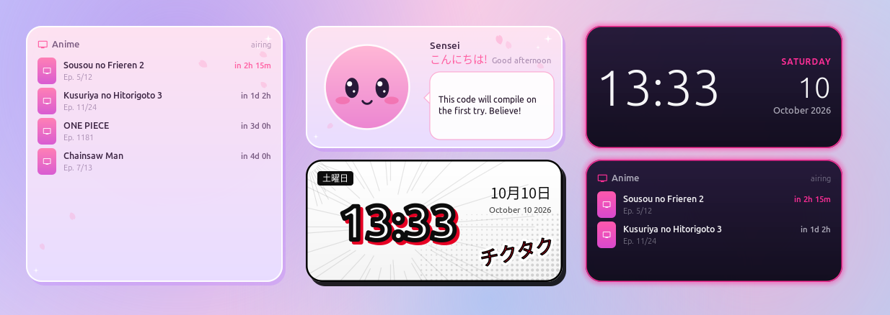

# DeskWidgets

**macOS-style desktop widgets for Linux** — clocks, calendar, weather, system monitors, now playing,
events, notes, exchange rates, Docker… and anime widgets. They snap to a grid, come in three sizes
and nine styles with any accent colour, every widget has its own settings, and writing your own
widget is a folder with two files.

🇺🇦 [Українською](README.uk.md)



## Features

* **21 widgets**: analog & digital clock, world clock, calendar (week/month), weather (now, hourly,
  3 days), up next (GNOME calendars, incl. Google), now playing (any MPRIS player, cover art, click to
  pause), system, processor, memory, disks, network (+ unknown-device watch), batteries (+ Bluetooth
  devices and Pulsar/Kysona-style 2.4 GHz gaming mice), Docker, note, countdown, picture, hryvnia exchange rates, and **anime**: next episodes from
  AniList, manga clock, anime buddy.
* **Grid**: hold <kbd>Super</kbd> and drag a widget — it snaps into the nearest free cell. On GNOME a
  small Shell helper shows the grid and the target cell while you drag.
* **Three sizes** for every widget: small (1×1 cell), medium (2×1), large (2×2), plus a global
  widget size from 80 % to 150 %.
* **Nine styles** — Glass, Graphite, Light, Colour, Sakura, Manga, Neon, and borderless (dark or light
  text) — and **13 accent colours** that tint the card and the highlights.
* **Settings for each widget** (city, cities, currencies, text, dates, pictures…) with a live preview.
  Right-click a widget to open them. Add several copies of the same widget.
* **Write your own** widget in Lua with a small drawing API — `deskwidgets new my_widget` gives you a
  working template. See [docs/creating-widgets.md](docs/creating-widgets.md).
* Ukrainian and English UI. Runs on X11 and on Wayland (through Xwayland).

| Styles | Sizes |
|---|---|
|  |  |



## Install

### Debian, Ubuntu, Mint, Pop!_OS

Download `deskwidgets_<version>_all.deb` from [Releases](../../releases) and:

```sh
sudo apt install ./deskwidgets_*_all.deb
```

Then open **DeskWidgets** from the app menu (the first start sets up autostart and
<kbd>Super</kbd>+<kbd>Alt</kbd>+<kbd>W</kbd>).

### Any distribution, from source

Dependencies: `conky` built with Lua + Cairo (Debian/Ubuntu: `conky-all`), Python 3 with PyGObject,
GTK 4 and libadwaita ≥ 1.5. Optional: Evolution Data Server GIR (events), `upower`, `nmap`, `docker`,
a Japanese font (anime widgets).

```sh
# Debian/Ubuntu
sudo apt install conky-all python3-gi gir1.2-gtk-4.0 gir1.2-adw-1 gir1.2-gdkpixbuf-2.0 \
                 gir1.2-ecal-2.0 gir1.2-edataserver-1.2 fonts-noto-cjk
# Fedora
sudo dnf install conky python3-gobject gtk4 libadwaita evolution-data-server google-noto-sans-cjk-fonts
# Arch
sudo pacman -S conky python-gobject gtk4 libadwaita evolution-data-server noto-fonts-cjk

git clone https://github.com/T0ks1k24/DeskWidgets
cd DeskWidgets
./install.sh            # into ~/.local; or: sudo ./install.sh --system
deskwidgets setup       # autostart, Super+Alt+W, GNOME grid helper
deskwidgets             # start
```

Try it without installing: `./bin/deskwidgets`. Check what is missing: `deskwidgets doctor`.

**Wireless gaming mice** (Pulsar, Kysona, ATK, VXE … on Compx/CX receivers) report their battery only
over a vendor protocol; DeskWidgets reads it itself. A from-source install needs a udev rule once
(the .deb and `--system` install it): `deskwidgets mice` prints the exact command and the result.

## Use

| | |
|---|---|
| <kbd>Super</kbd>+<kbd>Alt</kbd>+<kbd>W</kbd> or **DeskWidgets** in the app menu | the gallery: your widgets, add new ones, settings |
| hold <kbd>Super</kbd> and drag | move a widget; it snaps to the grid |
| right-click a widget | its settings (size, style, colour, options, remove) |
| left-click | widget actions: pause music, open the show on AniList… |

The command line does the same:

```sh
deskwidgets types                 # every available widget
deskwidgets add weather           # add one (as many copies as you like)
deskwidgets list                  # what is on the desktop
deskwidgets configure weather-2   # settings window of one widget
deskwidgets arrange               # pack everything onto the grid
deskwidgets preview clock --size large --style sakura -o clock.png
deskwidgets quit
```

The GNOME grid helper is a tiny Shell extension; GNOME on Wayland loads it after you log out and in
once. Without it widgets still snap, a moment after you drop them.

Configuration lives in `~/.config/deskwidgets/` — see [docs/configuration.md](docs/configuration.md).

## Make your own widget

```sh
deskwidgets new pomodoro
$EDITOR ~/.config/deskwidgets/widgets/pomodoro/widget.lua
deskwidgets reload && deskwidgets add pomodoro
```

A widget is `widget.json` (name, sizes, options → the settings window is generated from it) and
`widget.lua` (drawing). Read [docs/creating-widgets.md](docs/creating-widgets.md) and look at
[examples/](examples) and the built-in [widgets/](widgets). Pull requests with new widgets are welcome —
see [CONTRIBUTING.md](CONTRIBUTING.md).

## How it works

Each widget is its own small transparent [conky](https://github.com/brndnmtthws/conky) window drawn with
Cairo from Lua. A Python service (`deskwidgets run`) starts them, keeps them on the grid, restarts them
if they crash and feeds live data (MPRIS players, GNOME calendars). The gallery is a GTK 4 /
libadwaita app talking to the service over D-Bus.

```
bin/deskwidgets         launcher (CLI)
deskwidgets/            Python: service, gallery, grid, catalog, providers
engine/                 conky config, main.lua, lib.lua (the widget API)
widgets/<id>/           built-in widgets: widget.json + widget.lua (+ fetch scripts)
gnome-extension/        GNOME Shell grid helper
fonts/                  Material Design Icons (bundled)
packaging/              .deb build, screenshots
```

## Credits

* [conky](https://github.com/brndnmtthws/conky) draws everything.
* Icons: [Material Design Icons](https://pictogrammers.com/library/mdi/) (Pictogrammers Free License / Apache 2.0, bundled in `fonts/`).
* Data: [wttr.in](https://wttr.in), [AniList](https://anilist.co), [National Bank of Ukraine](https://bank.gov.ua/en/open-data/api-dev).

## License

MIT — see [LICENSE](LICENSE). The bundled icon font keeps its own license.
