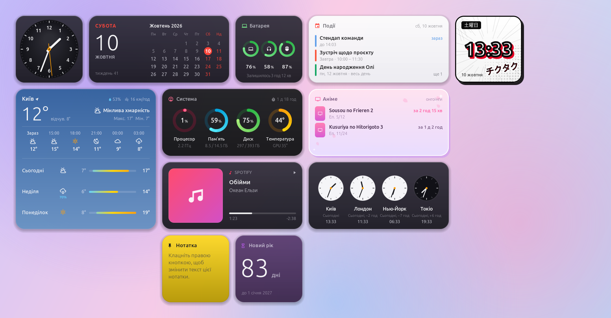
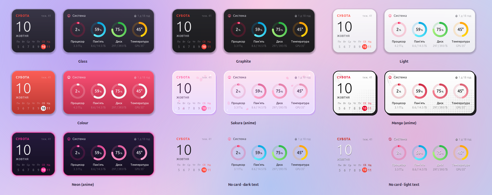
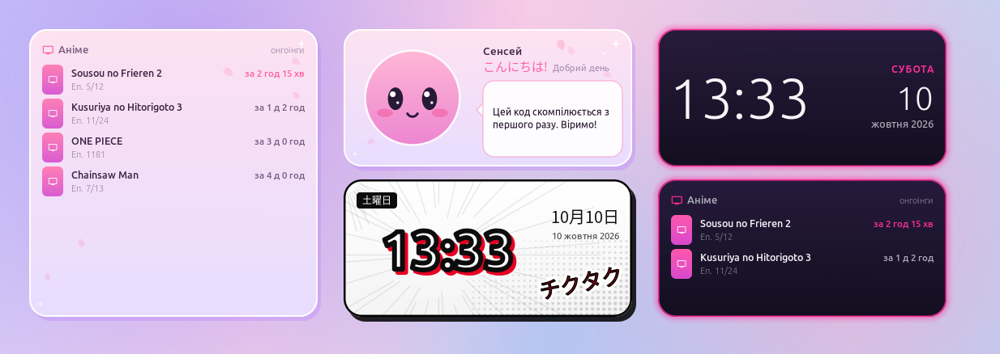

# DeskWidgets — віджети робочого столу

**Віджети в стилі macOS для Linux**: годинники, календар, погода, моніторинг системи, «Зараз грає»,
події, нотатки, курс НБУ, Docker… і аніме-віджети. Вони стоять по сітці, мають три розміри та дев’ять
стилів із будь-яким кольором, у кожного свої налаштування, а свій віджет — це тека з двома файлами.

🇬🇧 [English](README.md)



## Можливості

* **21 віджет**: аналоговий і цифровий годинник, світовий час, календар (тиждень/місяць), погода
  (зараз, погодинно, на 3 дні), події (календарі GNOME, зокрема Google), «Зараз грає» (будь-який
  плеєр MPRIS, обкладинка, клік — пауза), система, процесор, пам’ять, диски, мережа (+ контроль
  невідомих пристроїв), батарея (+ Bluetooth-пристрої та ігрові миші Pulsar/Kysona на 2.4 ГГц), Docker, нотатка, відлік, картинка, курс НБУ і
  **аніме**: нові серії з AniList, манґа-годинник, аніме-фраза.
* **Сітка**: затисніть <kbd>Super</kbd> і перетягніть віджет — він стане в найближчу вільну клітинку.
  У GNOME невелике розширення показує сітку й клітинку призначення під час перетягування.
* **Три розміри** для кожного віджета: маленький (1×1), середній (2×1), великий (2×2) і загальний
  масштаб віджетів від 80 % до 150 %.
* **Дев’ять стилів** — Скло, Графіт, Світлий, Кольоровий, Сакура, Манґа, Неон і без фону (темний чи
  світлий текст) — та **13 кольорів акценту**, що тонують картку й акценти.
* **Свої налаштування в кожного віджета** (місто, міста, валюти, текст, дати, картинки…) з живим
  прев’ю. Права кнопка миші на віджеті відкриває їх. Можна додати кілька однакових віджетів.
* **Свій віджет** пишеться на Lua з простим API для малювання — `deskwidgets new my_widget` створює
  робочу заготовку. Див. [docs/creating-widgets.md](docs/creating-widgets.md) (англійською).
* Інтерфейс українською та англійською. Працює в X11 і у Wayland (через Xwayland).




## Встановлення

### Debian, Ubuntu, Mint, Pop!_OS

Завантажте `deskwidgets_<версія>_all.deb` з [Releases](../../releases):

```sh
sudo apt install ./deskwidgets_*_all.deb
```

Відкрийте **Віджети** в меню програм — перший запуск увімкне автозапуск і
<kbd>Super</kbd>+<kbd>Alt</kbd>+<kbd>W</kbd>.

### Будь-який дистрибутив, з вихідних кодів

```sh
sudo apt install conky-all python3-gi gir1.2-gtk-4.0 gir1.2-adw-1 gir1.2-gdkpixbuf-2.0 \
                 gir1.2-ecal-2.0 gir1.2-edataserver-1.2 fonts-noto-cjk
git clone https://github.com/toksik/deskwidgets
cd deskwidgets
./install.sh            # у ~/.local; або: sudo ./install.sh --system
deskwidgets setup       # автозапуск, Super+Alt+W, підказка-сітка GNOME
deskwidgets             # запуск
```

Без встановлення: `./bin/deskwidgets`. Чого бракує — покаже `deskwidgets doctor`.

**Бездротові ігрові миші** (Pulsar, Kysona, ATK, VXE … з приймачами Compx/CX) повідомляють заряд лише
власним протоколом — DeskWidgets читає його сам. При встановленні з вихідних кодів один раз потрібне
правило udev (.deb і `--system` ставлять його самі): `deskwidgets mice` покаже команду й результат.
Для Fedora й Arch — див. [README.md](README.md#any-distribution-from-source).

## Як користуватися

| | |
|---|---|
| <kbd>Super</kbd>+<kbd>Alt</kbd>+<kbd>W</kbd> або **Віджети** в меню | галерея: ваші віджети, додати нові, налаштування |
| затиснути <kbd>Super</kbd> і тягнути | пересунути віджет; він стане по сітці |
| права кнопка на віджеті | його налаштування (розмір, стиль, колір, параметри, прибрати) |
| ліва кнопка | дії віджета: пауза музики, відкрити аніме на AniList… |

Те саме з терміналу: `deskwidgets types`, `add weather`, `list`, `configure weather-2`, `arrange`,
`preview clock --size large --style sakura -o clock.png`, `quit`.

Підказка-сітка GNOME — маленьке розширення оболонки; GNOME у Wayland завантажує його після
повторного входу в систему. Без нього віджети теж стають по сітці — за мить після того, як їх
відпустити.

Налаштування — у `~/.config/deskwidgets/`, див. [docs/configuration.md](docs/configuration.md).

## Свій віджет

```sh
deskwidgets new pomodoro
$EDITOR ~/.config/deskwidgets/widgets/pomodoro/widget.lua
deskwidgets reload && deskwidgets add pomodoro
```

Віджет — це `widget.json` (назва, розміри, параметри — з них будується вікно налаштувань) і
`widget.lua` (малювання). Приклади — у [examples/](examples) і [widgets/](widgets). Пул-реквести з
новими віджетами вітаються — див. [CONTRIBUTING.md](CONTRIBUTING.md).

## Ліцензія

MIT — див. [LICENSE](LICENSE). Вбудований шрифт іконок має власну ліцензію.
